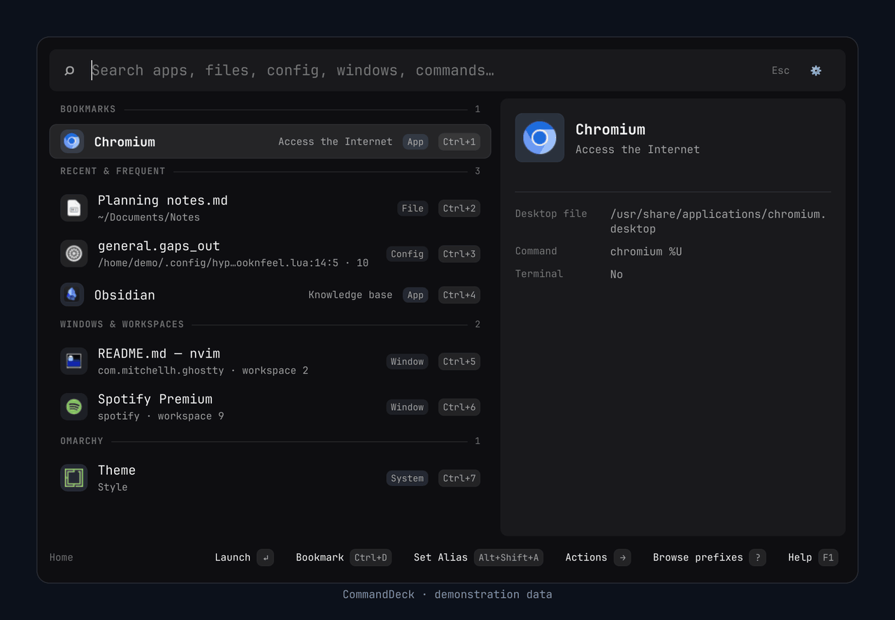

# CommandDeck

[](https://github.com/devmobasa/CommandDeck/actions/workflows/validation.yml)
[](LICENSE)


A keyboard-first command palette and launcher for **Omarchy and Hyprland**.
Press **Ctrl+Space**, type, and act.

[](docs/gallery.md)

> [!NOTE]
> **Working preview.** Download a prebuilt release or build it from source. The
> desktop integration needs Omarchy's Quattro shell plugin system, or the
> experimental standalone Hyprland host. The extension SDK is experimental.

[What it does](#what-it-does) · [Install](#install) · [Hotkey](#hotkey) · [First steps](#first-steps) ·
[Configuration](#configuration) · [Documentation](#documentation) ·
[Development](#development) · [Gallery](docs/gallery.md) · [Showcase](docs/showcase.md)

## What it does

- **One search for the desktop.** Find apps, files and file text, Hyprland
  config keys, windows, workspaces, Omarchy menu actions, user services,
  projects, snippets, emoji, and settings. Typos are fine: `fierf` still finds
  Firefox.
- **Switch, don't duplicate.** Enter switches to an app that is already open.
  Shift+Enter opens a new window.
- **Made for Omarchy.** It uses the colors of the active Omarchy theme. It opens
  [Omarchy submenus](docs/search-and-ranking.md#omarchy-submenus) in place and
  shows a config key at its file and line. It follows Hyprland's rounding, so
  `rounding = 0` gives square corners throughout.
- **Calculator.** Type `100 * 5`, `1,000 * 1.2`, `100 km to miles`,
  `100 usd to eur`, or `days until 11 sep`. You do not need `=`.
- **Large Type.** **Ctrl+L** shows your search, or a calculator answer, across
  the whole screen.
- **Drag files out.** Drag a file row into a terminal, browser, or chat.
- **Run programs.** Type `>` and a command, for example `> htop`.
- **Herdr.** `herdr:` finds [Herdr](docs/search-and-ranking.md#herdr-spaces-and-tabs)
  spaces and tabs. `htab:` finds tabs only and shows which agent tabs need attention.
  `agents:` lists every agent, blocked ones first. In a space, a name that no tab
  has offers **Create tab**.
- **Learn your keys.** A row that has a Hyprland shortcut shows it. Apps and
  commands offer **Copy Hyprland Binding**, a ready-to-paste `hl.bind` line.
- **Controls that say what they do.** Desktop controls name the next step:
  **Mute** or **Unmute**, **Turn Wi-Fi Off**, **Enter Fullscreen**.
- **More sources.** Clipboard history, HEY mail, desktop controls, time zones,
  quicklinks, and web search. Type an address such as `github.com/devmobasa`
  to open it, or choose **Save as Quicklink…**.
- **Optional AI.** Ask a direct provider, or the embedded assistant (Codex,
  Claude Code, Cursor, or Grok). The daemon enforces the trust level that you select.
- **Extensions.** Experimental C# extensions run as separate, sandboxed processes.
- **Keyboard first.** You can do everything from the keyboard. Every control
  also works with the mouse.
- **Fast.** A Native AOT C# daemon keeps an SQLite FTS5 index, the hotkey
  starts no process, and the launcher's surface stays ready while it is
  closed. In our measurements, the card with its Home results shows about
  6 ms after the shortcut
  ([median, with the timing details](docs/testing.md#hotkey-to-visible-latency)).
- **Private by default.** There is no telemetry. AI, clipboard history, search
  history, and extensions stay off until you turn them on. Usage learning is on,
  stays on your computer, and you can turn it off. See
  [security and privacy](docs/security.md).

CommandDeck uses **Ctrl+Space**. [Hotkey](#hotkey) shows how to use a different
chord or bind it yourself.

## Install

### Download a release (no .NET needed)

This is the recommended way. Do these steps in your Omarchy desktop session.

1. Open the [latest release](https://github.com/devmobasa/CommandDeck/releases/latest).
   Download `commanddeck-VERSION-linux-x64.tar.gz` and its `.sha256` file.
   On an ARM computer, use the `linux-arm64` files.
2. Check the download, extract it, and run the installer. Set `version` to the
   release that you downloaded:

   ```bash
   version=v0.1.0-preview.1
   sha256sum -c commanddeck-$version-linux-x64.tar.gz.sha256
   tar -xzf commanddeck-$version-linux-x64.tar.gz
   cd commanddeck-$version-linux-x64
   ./install.sh
   ```

The installer needs `jq` and `icu` (`sudo pacman -S --needed jq icu`). To check
the requirements first without changes, run `./install.sh --dry-run`.

The installer puts the app in `~/.local/share/commanddeck`, and it installs the
user service and the Omarchy plugin. It indexes your folders, and then it binds
**Ctrl+Space**. To use a different chord, add `--hotkey="SUPER + SPACE"`. The
installer restarts the Omarchy shell. It keeps your existing configuration and
backs up the plugin and binding files that it changes. If a step fails, it
restores the previous installation. To update, install the new release in the
same way.

### Build from source

1. Install the .NET SDK pinned in [global.json](global.json). The
   [installation guide](docs/install.md#install-the-pinned-sdk) shows an
   installer that reads the pin.
2. On Arch, install the native build tools:

   ```bash
   sudo pacman -S --needed base-devel clang zlib sqlite icu shellcheck bubblewrap wl-clipboard jq
   ```

3. Get the source, then build and test it:

   ```bash
   git clone https://github.com/devmobasa/CommandDeck.git
   cd CommandDeck
   dotnet restore CommandDeck.slnx --locked-mode
   ./scripts/build.sh
   ./scripts/test.sh
   ```

4. In a running Omarchy Quattro session, install the app and the plugin:

   ```bash
   ./scripts/reinstall-all.sh
   ```

This script validates the repository and publishes the Native AOT binary. Then
it runs the same installer as a release, `scripts/install.sh`, on the result.
It accepts the same `--hotkey` and `--reset-config` options.

> [!WARNING]
> Review your indexed folders before the first index. By default, CommandDeck
> indexes the file names in your home folder, hidden files included. Privacy
> exclusions always apply. See [configuration](docs/configuration.md).

To turn CommandDeck off again:

```bash
commanddeck hotkey remove
hyprctl reload
omarchy plugin disable local.commanddeck
omarchy restart shell
systemctl --user disable --now commanddeck.service
```

The [installation guide](docs/install.md) covers updates, uninstalling, manual
installation, troubleshooting, rollback, and the standalone host.

## Hotkey

The installer binds **Ctrl+Space** for you. To use a different chord, pass
`--hotkey="SUPER + SPACE"` to the installer, or run:

```bash
commanddeck hotkey check --chord "SUPER + SPACE"     # validate only; changes nothing
commanddeck hotkey install --chord "SUPER + SPACE"
hyprctl reload
```

`commanddeck hotkey install` writes its own Hyprland Lua module,
`~/.config/hypr/commanddeck.lua`:

```lua
hl.unbind("CTRL + SPACE")
hl.bind("CTRL + SPACE", hl.dsp.global("commanddeck:toggle"), { description = "CommandDeck" })
```

It also adds one line to `~/.config/hypr/hyprland.lua`, directly after
`require("hypr.bindings")`, so the chord replaces a binding of the same keys:

```lua
if package.searchpath("hypr.commanddeck", package.path) then require("hypr.commanddeck") end -- CommandDeck hotkey
```

The module also turns off Hyprland's fade for CommandDeck's windows, so they
open and close at once.

To bind it yourself instead, put the `hl.bind` line in your own bindings. The
key sends Hyprland's global `commanddeck:toggle` to the CommandDeck plugin in the
Omarchy shell, so a key press starts no process. `commanddeck hotkey remove`
deletes the module and the line. [Manual installation](docs/install.md#manual-installation)
has the details.

## First steps

Press **Ctrl+Space** and type. Try these searches:

| Type | Result |
|---|---|
| `firefox` | Launch an app, or switch to it when it is already open |
| `gaps` | The Omarchy gaps toggle and the Hyprland gap keys |
| `100 * 5` | `500`. Press Enter to copy it |
| `100 usd to eur` | Currency, with daily ECB rates |
| `days until 11 sep` | A date count |
| `> htop` | Run a program |
| `fierf` | Firefox, typo and all |
| `reduce motion` | The setting, opened and highlighted in Settings |
| `github.com/devmobasa` | Open the address, or save it as a quicklink |
| `htab:` | Herdr tabs and their agent status |
| `agents:` | Every Herdr agent, the most urgent first |

| Key | Action |
|---|---|
| **Enter** | Open or run the selected result; an open app is focused |
| **Shift+Enter** | Open a new window of an app that is already open |
| **Ctrl+K** | Show the actions for the result |
| **Ctrl+L** | Show the search, or a calculator answer, across the screen |
| **Ctrl+1** to **Ctrl+9** | Run a numbered result |
| **?** | Show all prefixes, with examples |
| **F1** | Show all shortcuts |
| **Ctrl+,** | Open Settings |
| **Escape** | Close CommandDeck |
| **Shift+Escape** | Go back to an empty search on Home |

A prefix limits the search to one source:

| Prefix | Finds |
|---|---|
| `app:` / `file:` / `text:` | Apps, files, and file text |
| `cfg:` / `oma:` | Config keys and Omarchy controls |
| `win:` / `ws:` | Windows and workspaces |
| `herdr:` / `htab:` / `agents:` | Herdr spaces and tabs, tabs only, or agents |
| `clip:` / `snip:` / `proj:` | Clipboard history, snippets, and projects |
| `ctl:` / `kill:` / `svc:` | Desktop controls, your processes, and user services |
| `link:` / `web:` / `tz:` / `emoji:` | Quicklinks, web search, time zones, and emoji |
| `ai:` / `hey:` | The AI assistant and HEY mail |
| `=` / `>` | The full calculator, and run a program |

You can combine and exclude filters, for example `file: app: roadmap -workspaces:`.
The [launcher guide](docs/launcher-workflows.md) and the
[search reference](docs/search-and-ranking.md) show all workflows and prefixes.

## Configuration

Open Settings with the gear button or **Ctrl+,**. Settings has seven pages:
Search, AI, Editors, Filters, Shortcuts, Customization, and Diagnostics. On
narrow screens, use the page picker. **Home** and **End** go to the top or bottom
of a page.

- **Search.** Type in the field at the top of the sidebar. Settings opens the
  page with the best match and outlines the control. When you stop typing, the
  rest of the window dims briefly around it. Enter moves to it. The launcher
  finds the same settings.
- **Shortcuts.** Find a key or a binding, for example `super+space`. The page
  shows CommandDeck's own shortcuts and your Hyprland bindings.
  Click a pill to record a key; changed desktop bindings can be restored.
- **Diagnostics.** The version, process, socket, start time, and recent search
  times. **Copy debug info** copies them for a bug report.
- **Interface font.** **Customization → Appearance** offers Sans (default) and
  Shell font. Paths, commands, and key chords keep the shell font.

Other options are in the configuration file,
`~/.config/commanddeck/commanddeck.jsonc`. Start from the
[example configuration](config/commanddeck.example.jsonc) and read the
[configuration reference](docs/configuration.md).

## Documentation

Start with the [documentation overview](docs/README.md). It explains each part
in plain words.

- [Install](docs/install.md): install a release or build from source, update, uninstall, and troubleshoot.
- [Launcher workflows](docs/launcher-workflows.md): projects, snippets, clipboard, programs, and more.
- [Search and ranking](docs/search-and-ranking.md): prefixes, the calculator, and result order.
- [Configuration](docs/configuration.md): every option.
- [AI](docs/ai.md) and [HEY mail](docs/hey-mail.md): the optional integrations.
- [Extensions](docs/extensions/README.md): experimental C# extensions.
- [Security and privacy](docs/security.md), [permissions](docs/permissions.md),
  and the [security policy](SECURITY.md).
- [Gallery](docs/gallery.md): screenshots of each feature.
- [Showcase](docs/showcase.md): short animated tours of changing shortcuts,
  finding settings, and the Settings design.

## Development

```bash
dotnet restore CommandDeck.slnx --locked-mode
./scripts/build.sh
./scripts/test.sh
dotnet format CommandDeck.slnx --verify-no-changes --no-restore
dotnet run --project tests/CommandDeck.Specs -c Release -- --category Core
```

The backend is C# in `src/`. The Quickshell/QML frontend is in `qml/`. Tests are
in `tests/`, and tools for build, validation, and install are in `scripts/`.
Read [CONTRIBUTING.md](CONTRIBUTING.md) for the rules and the test gates, and
the [architecture guide](docs/architecture.md) for the code map.
[Report a bug](https://github.com/devmobasa/CommandDeck/issues).

## License

CommandDeck is available under the [MIT license](LICENSE).
